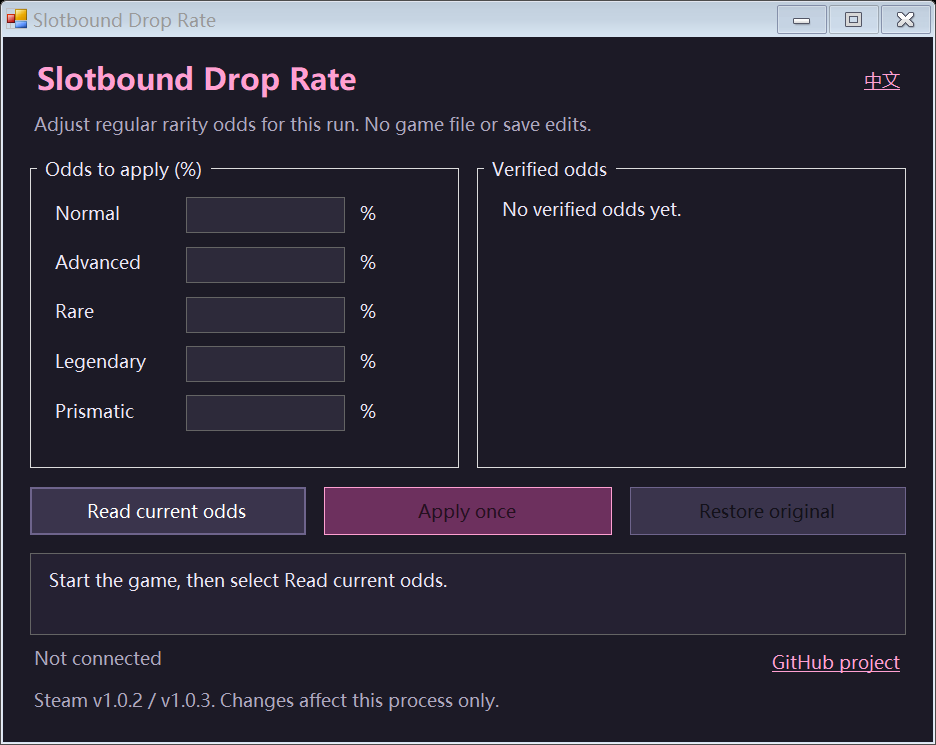

# Slotbound Drop Rate Editor

[简体中文](README.md) · **English** · [English website](https://zyw313313-collab.github.io/slotbound-drop-rate/en.html) · [Report an issue](https://github.com/zyw313313-collab/slotbound-drop-rate/issues)

Adjust Normal, Advanced, Rare, Legendary, and Prismatic rarity odds during a single-player run. The tool does not directly edit game files or saves. Switch the app language in the top-right corner.

## Download and install

- **Portable:** download the [Windows ZIP](https://github.com/zyw313313-collab/slotbound-drop-rate/releases/latest/download/SlotboundDropRate.zip), extract the whole ZIP to a writable folder, and open `SlotboundDropRate.exe`. Keep the EXE, `slotbound-compatibility.ini`, and `update-compatibility.bat` together. Do not launch the tool from inside the ZIP.
- **One-click install:** download and run [install.bat](https://raw.githubusercontent.com/zyw313313-collab/slotbound-drop-rate/main/install.bat). It installs the tool in `%LOCALAPPDATA%\SlotboundDropRate` and creates a desktop shortcut.

Requires **Windows 10 / 11 x64**. The profile bundled with this release matches **Slotbound v1.0.4 (Steam build `26899345`)**. Older builds are not maintained.

## Adjust the odds

1. Start the game and enter a single-player run. Back up `%APPDATA%\slotbound_full` before testing.
2. Open the editor and select **Read current odds**. Enter five percentages that add up to **100%**. Wait until the reels stop, then select **Apply once**.
3. Hover over the odds icon in the game and verify an actual summon. The setting affects *regular rarity rolls after a winning spin*, not the chance of winning a spin. Guarantees, items, and scripted rewards can use separate rules.
4. Select **Restore original** when done. Restarting the game also clears changes to the live odds, but ordinary saves may retain rewards you already obtained.

## After a minor Steam update: update the profile yourself

**Can you read the odds but see a diagnostics-only notice?** You don't need to copy a build ID, calculate a hash, or rebuild. Use **v1.2.1 or later**, which includes the [compatibility helper](update-compatibility.bat). The launcher alone does not add this feature to an older EXE.

1. **Quit to desktop and restart the updated game.** Note the actual version in the bottom-left corner of the game's main menu, then enter a disposable single-player run. Close any open editor windows, but leave the game running.
2. Double-click `update-compatibility.bat` in the **tool folder**. For a one-click install, paste `%LOCALAPPDATA%\SlotboundDropRate` into File Explorer's address bar to find it.
3. The helper scans the running game without writing to it and automatically reads the Steam build and data-package SHA-256. Enter the game version when prompted, e.g. `1.0.5` (without `v`). If the checks pass, it creates `slotbound-compatibility.candidate.ini` without replacing the active profile.
4. The replacement prompt defaults to **No**. Select **Yes** to back up any existing profile as `slotbound-compatibility.backup-*.ini` and install the candidate as `slotbound-compatibility.ini`. If no active profile exists, there's nothing to back up.
5. Reopen the tool and test **reading, applying, actual summons, and restoring** in the disposable run. A read-only scan does not prove the game still uses those odds. The test profile stays on your machine; nothing is uploaded or published.

- **Already matched:** no replacement is needed. Open the tool and read the odds.
- **Scan failed or no candidate:** check that you restarted the game and entered a run. If the runtime does not match or the game table cannot be validated, wait for a tool update rather than forcing a profile.
- **Something went wrong after replacing it:** restore the original odds or restart the game, then close the editor. Copy the backup over `slotbound-compatibility.ini` or re-extract the project's release ZIP. Restoring a profile **does not make it compatible with a new game build**.

## Build and maintenance

See the [maintainer guide](docs/maintainer.md) for build, test, and release steps. This is an unofficial tool for single-player use only. Do not use it in multiplayer or in ways that affect other players.
