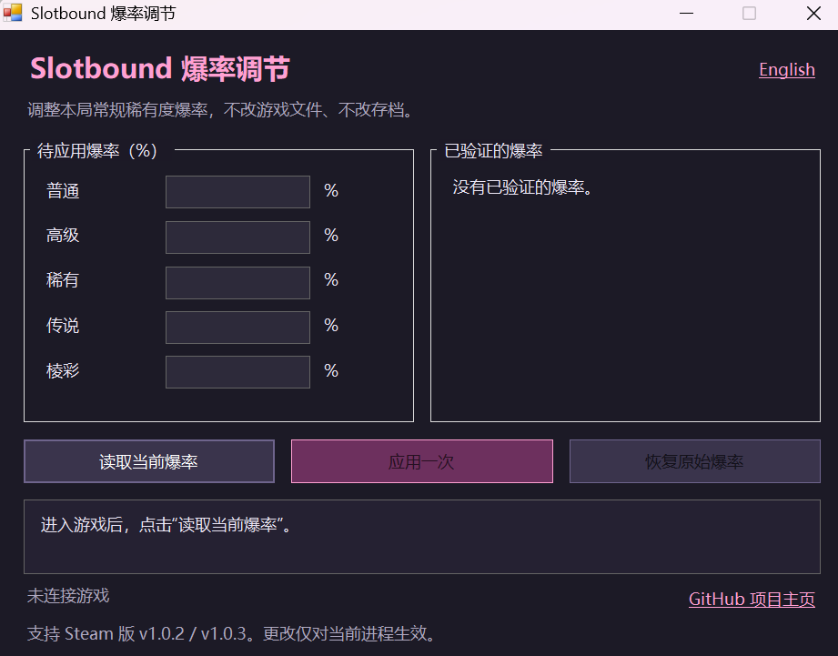

# 转运军团（Slotbound）爆率调节

**简体中文** · [English](README.en.md) · [中文网站](https://zyw313313-collab.github.io/slotbound-drop-rate/) · [报告问题](https://github.com/zyw313313-collab/slotbound-drop-rate/issues)

在运行中的单机游戏里调整普通、高级、稀有、传说和棱彩五档爆率。工具不会直接修改游戏文件或存档。应用界面可在右上角切换中英文。

## 下载与安装

- **免安装：**下载 [Windows ZIP](https://github.com/zyw313313-collab/slotbound-drop-rate/releases/latest/download/SlotboundDropRate.zip)，完整解压到可写目录，再打开 `SlotboundDropRate.exe`。保留 EXE、`slotbound-compatibility.ini` 和 `update-compatibility.bat` 在同一目录，不要在 ZIP 内直接运行。
- **一键安装：**下载并运行 [install.bat](https://raw.githubusercontent.com/zyw313313-collab/slotbound-drop-rate/main/install.bat)，安装到 `%LOCALAPPDATA%\SlotboundDropRate` 并创建桌面快捷方式。

适用 **Windows 10 / 11 x64**。本次发布随附的配置适配 Steam 版 **Slotbound v1.0.4（构建 `26899345`）**；不维护旧构建。

## 调整爆率

1. 启动游戏，进入单机对局并等待加载完成。建议先备份 `%APPDATA%\slotbound_full`。
2. 打开工具，点击 **读取当前爆率**。输入五项百分比，合计必须为 **100%**，转盘停稳后再点击 **应用一次**。
3. 鼠标悬停在游戏内的概率图标上查看显示，并用实际召唤确认。设置改变的是**中奖后的常规稀有度判定**，不保证转盘中奖；保底、道具和脚本奖励可能使用独立规则。
4. 不再使用时点击 **恢复原始爆率**。退出并重启游戏也会清除内存改动，但正常存档可能保留已经获得的奖励。

## Steam 小更新后：自己更新配置

**能读到爆率，但工具提示「仅诊断，禁止写入」？** 不必手抄构建号、计算哈希或重新编译。先确认你使用的是包含 [兼容助手](update-compatibility.bat) 的 **v1.2.1 或更新版本**，不能只把脚本放到旧 EXE 旁边。

1. **退出到桌面并重启更新后的游戏**，记下游戏主菜单左下角的实际版本号，再进入一个可丢弃的单机测试局。关闭已经打开的修改器窗口；游戏保持运行。
2. 在**修改器目录**双击 `update-compatibility.bat`。如果是通过一键安装脚本安装的，可以把 `%LOCALAPPDATA%\SlotboundDropRate` 粘贴到资源管理器地址栏打开该目录。
3. 助手只读检查运行中的游戏，自动取得 Steam 构建号和数据包 SHA-256。提示时输入主菜单显示的版本号，例如 `1.0.5`（不带 `v`）。通过检查后会生成 `slotbound-compatibility.candidate.ini`，此时不会替换现用配置。
4. 替换提示默认选 **否**。选 **是**才会把已有配置备份为 `slotbound-compatibility.backup-*.ini`，并将候选安装为 `slotbound-compatibility.ini`。如果原来没有配置，就不会产生备份。
5. 重新打开修改器，在测试局中确认**读取、应用、实际召唤和恢复**都正常。只读扫描通过不代表召唤规则保持不变；此配置仅供本机试用，不会上传或发布。

- **显示「当前配置已匹配」：**无须替换；直接打开工具读取爆率。
- **扫描失败或生成不了候选：**先确认游戏已重启并进局。若运行时不匹配或概率表无法验证，等待工具更新，不要手动强行放行。
- **替换后异常：**恢复爆率或重启游戏，再关闭工具。将备份文件复制为 `slotbound-compatibility.ini` 覆盖现用文件，或者重新解压项目发布包。回退配置**不代表旧配置支持新游戏构建**。

## 维护与构建

维护者可以参考 [构建与发布指南](docs/maintainer.md)。本工具为非官方项目，仅供单机使用，请勿用于联机或影响其他玩家的场景。
