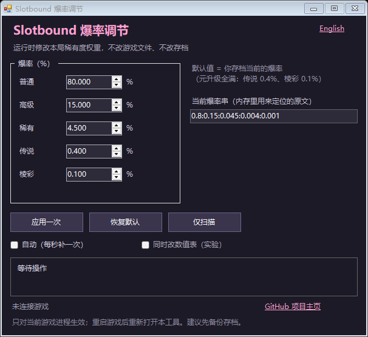

# Slotbound 爆率调节 / Slotbound Drop Rate

> 运行时修改本局稀有度权重 —— **不改游戏文件、不改存档、不碰联机**。
> Adjust this run's rarity odds at runtime — **no file edits, no save edits, single-player only**.

[](https://github.com/zyw313313-collab/slotbound-drop-rate/releases/latest)
[](https://zyw313313-collab.github.io/slotbound-drop-rate/)
[](https://zyw313313-collab.github.io/slotbound-drop-rate/en.html)

**中文** ｜ [English](#english)



## 中文

### 功能

- 五个稀有度独立调节：普通 / 高级 / 稀有 / 传说 / 棱彩
- 「应用一次」立即改写本局爆率串
- 「自动」每秒补一次，新开一局也自动生效
- 「恢复默认」一键还原
- 中 / 英双语：跟随系统语言，也可在窗口右上角切换
- 可选「同时改数值表（实验）」兼容把权重存成数字的版本

默认值来自全元升级存档的真实爆率：**80 / 15 / 4.5 / 0.4 / 0.1**（即传说 0.4%、棱彩 0.1%）。

### 下载 / 安装

- **直接下载**：[SlotboundDropRate.exe](https://github.com/zyw313313-collab/slotbound-drop-rate/releases/latest/download/SlotboundDropRate.exe)
- **一键安装脚本**：[install.bat](https://github.com/zyw313313-collab/slotbound-drop-rate/raw/main/install.bat)（下载到 `%LOCALAPPDATA%\SlotboundDropRate` 并创建桌面快捷方式）

需要 Windows 10/11，.NET Framework 4.x（系统自带）。

### 使用

1. 启动游戏，进入一局，先拉一次杆。
2. 运行 `SlotboundDropRate.exe`，UAC 弹窗点「是」。
3. 工具自动连接 `Slotbound.exe`，底部显示 PID。
4. 填百分比 → **应用一次**；底部会显示匹配/改写数量。
5. 想对新开一局生效：勾 **自动**。

> 游戏的数据包 `Slotbound.dat` 是加密的，改文件不可行；本工具只写运行中进程内存，关闭游戏即恢复。建议先备份 `%APPDATA%\slotbound_full`。

## English

### Features

- Five rarities, fully adjustable: Normal / Advanced / Rare / Legendary / Prismatic
- **Apply once** rewrites the current run's odds string immediately
- **Auto** re-applies every second, so newly started runs are patched automatically
- **Restore defaults** to revert
- Bilingual UI (Chinese / English), follows your system language, switchable in the top-right corner
- Optional **Also patch number tables (experimental)** for builds that cache odds as numbers

Defaults match a fully upgraded save: **80 / 15 / 4.5 / 0.4 / 0.1** (Legendary 0.4%, Prismatic 0.1%).

### Download / Install

- **Direct download**: [SlotboundDropRate.exe](https://github.com/zyw313313-collab/slotbound-drop-rate/releases/latest/download/SlotboundDropRate.exe)
- **One-click installer**: [install.bat](https://github.com/zyw313313-collab/slotbound-drop-rate/raw/main/install.bat) (downloads to `%LOCALAPPDATA%\SlotboundDropRate` and creates a desktop shortcut)

Windows 10/11 with .NET Framework 4.x (included in the OS).

### Usage

1. Start the game, enter a run and spin once.
2. Run `SlotboundDropRate.exe` and accept the UAC prompt.
3. It connects to `Slotbound.exe` automatically; the status bar shows the PID.
4. Set the percentages, click **Apply once**; the status line reports matches/writes.
5. Tick **Auto** to keep new runs patched.

> The game's data is packed in an encrypted `Slotbound.dat`, so file editing is not possible. This tool only writes to the running process; restarting the game restores vanilla. Back up `%APPDATA%\slotbound_full` first.

## 自己编译 / Build

需要 Windows 自带的 .NET Framework 4.x（`csc.exe`）：

```powershell
powershell -ExecutionPolicy Bypass -File build.ps1
```

产物：`dist\SlotboundDropRate.exe`。

## 结构 / Layout

```
src/SlotboundDropRate.cs   主程序（WinForms + ReadProcessMemory/AOB 扫描，中英双语）
src/app.manifest           要求管理员权限（游戏通常由管理员 Steam 启动）
assets/icon.ico            图标
docs/                      GitHub Pages 站点（index.html 中文 / en.html English）
build.ps1                  编译脚本
install.bat                一键安装脚本
```

## 免责声明 / Disclaimer

仅供单机娱乐，非官方工具。使用风险自负；请勿用于联机或任何影响他人的场景。
Unofficial tool, single-player entertainment only. Use at your own risk; do not use it for multiplayer or anything that affects other players.
